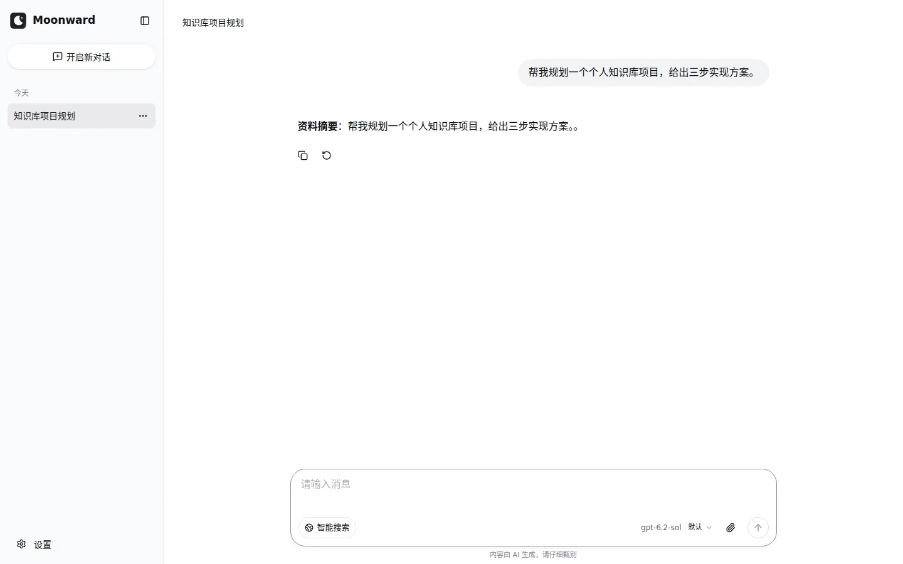
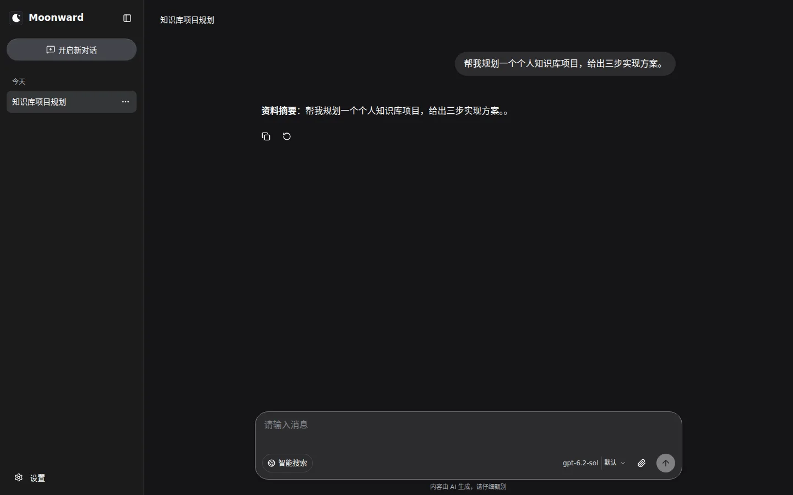
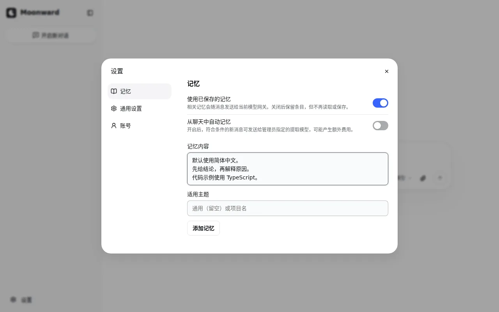
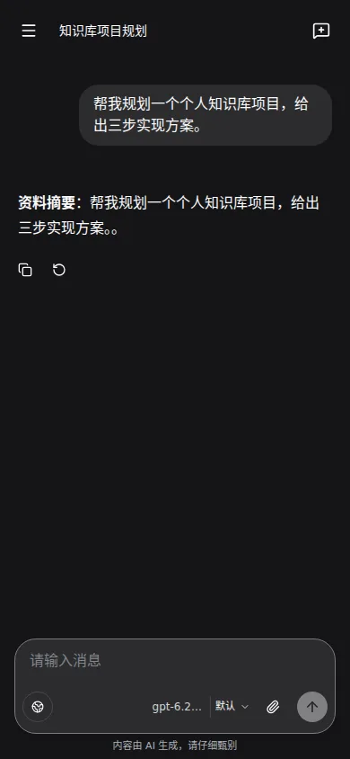

# Moonward

可独立部署的 AI 聊天站，接入兼容 OpenAI Responses API 的模型网关。支持多用户、异步对话和个人记忆，网页与 API 共用一个端口。



## 功能

- **聊天** — Markdown、代码高亮、公开思考摘要、推理深度调节，以及模型支持的联网搜索、图片和文档输入。
- **异步生成** — 多个对话可同时回复，刷新页面后继续接收后台任务的输出；单轮请求最长 10 分钟。
- **个人记忆** — 查看、编辑和删除已保存的记忆，新对话可选择停用；自动提取由管理员配置模型、用户自行开启。
- **站点管理** — 在网页中配置 API、模型显示名称、上下文与输出上限，管理用户、邀请和每日配额。
- **界面** — 深浅主题、移动端布局、自动话题命名，以及单文件 HTML 代码预览。预览支持内联样式，脚本和外部资源受限。

## 界面预览

以下截图均使用演示账号和模拟回复。

<details>
<summary>查看深色模式、记忆管理与手机界面</summary>

### 深色模式



### 记忆管理



### 手机界面



</details>

## 快速部署

准备 Node.js 24 和 Docker Compose v2。下面的步骤适用于全新部署；已有数据库请先阅读[升级与备份说明](deploy/postgres.md#旧版升级)。

```bash
git clone https://github.com/breeze303/Moonward.git
cd Moonward
node deploy/init-env.mjs
```

生成器创建含随机密钥的私有 `.env`，已有文件会保留。默认地址为 `http://localhost:18091`，监听 `127.0.0.1`。远程部署时，先按 [`.env.example`](.env.example) 编辑配置。

| 配置 | 用途 |
| --- | --- |
| `APP_ORIGIN` | 浏览器实际访问的地址，例如 `https://chat.example.com` |
| `BIND_IP` | 同机反代使用 `127.0.0.1`；跨机器、局域网或 EasyTier 回源可设为内网 IP 或 `0.0.0.0` |
| `PUBLISH_PORT` | 对外提供网页和 API 的单个端口，默认 `18091` |

```bash
(umask 077 && mkdir -p ./data/postgres)
docker compose up -d --build --wait
```

1. 打开站点的 `/setup`，立即创建管理员。首个成功提交者成为管理员，完成后初始化入口关闭。
2. 在「设置 → 账号 → 站点管理 → API 配置」填写网关地址和 API Key，再到「模型管理」添加并启用模型。
3. 在「用户与用量」新增账号或生成邀请链接。密码长度为 10–128 个字符。

## 运行与维护

- **反向代理** — 将整个站点转发到应用端口，保留浏览器域名对应的 `Host` 和原始 `Origin`。关闭 SSE 缓冲，读取超时至少 11 分钟。远程登录使用 HTTPS；CDN 跳过 `/api/*` 缓存。
- **数据存储** — Docker 部署使用 PostgreSQL 17，账号、聊天、附件和设置统一保存在 `./data/postgres/`。用 `pg_dump` 备份数据库，同时保管原 `.env`；其中 `AUTH_SECRET` 用于解密网关密钥。
- **更新** — 执行 `docker compose up -d --build --wait`，用 `docker compose ps` 检查服务。数据库迁移、旧卷迁移和并发验收见[部署文档](deploy/postgres.md)。

## 开发与检查

```bash
npm ci
npm run dev           # 启动本地开发服务
npm run type          # TypeScript 检查
npm test              # 单元与接口测试
npm run build         # 构建前端
npm run test:browser  # Playwright 浏览器测试
```

浏览器测试使用本地模拟网关。可通过 `BROWSER_EXECUTABLE` 指定 Chrome，或先执行 `npx playwright install chromium`。PostgreSQL 专项测试需要[独立测试数据库](deploy/postgres.md#验收与恢复)。

## 许可证

基于 [MIT 许可证](LICENSE) 发布。聊天布局、主题、Markdown 渲染及部分浏览器代码来自 DeepSeek 的 `chat-demo`。
